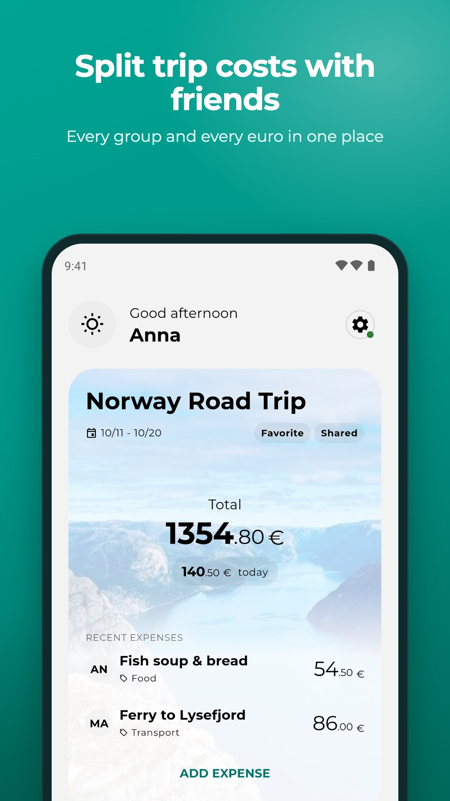
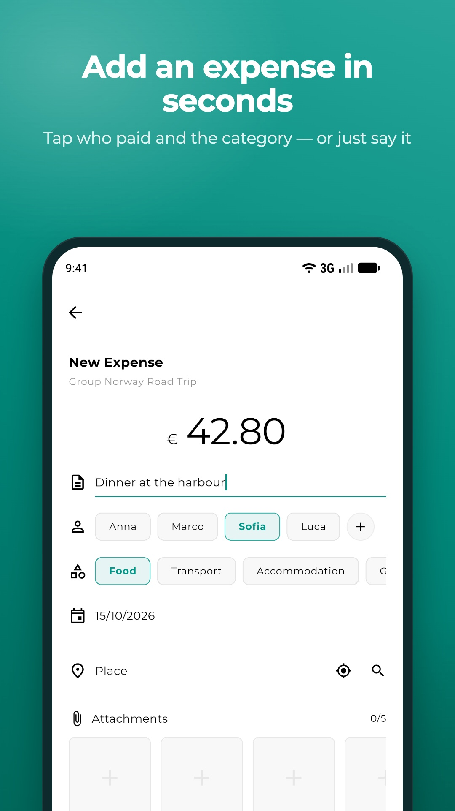
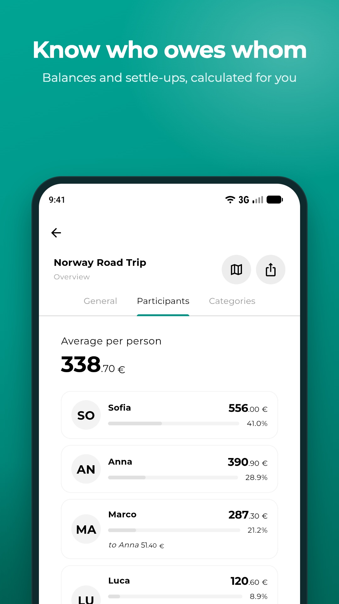
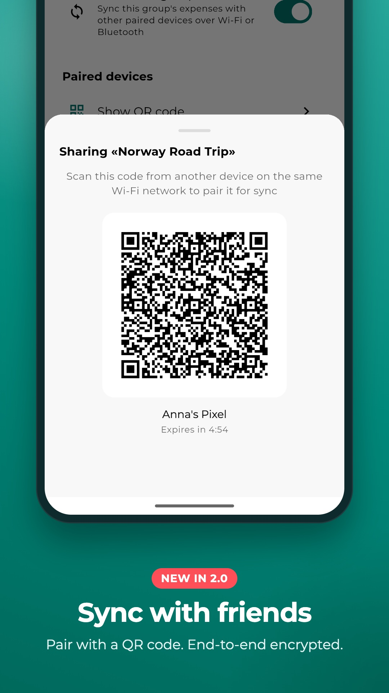
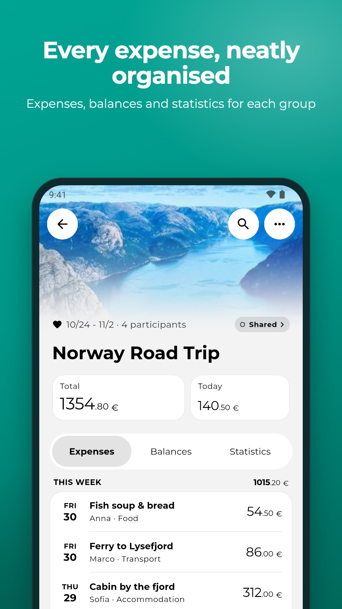
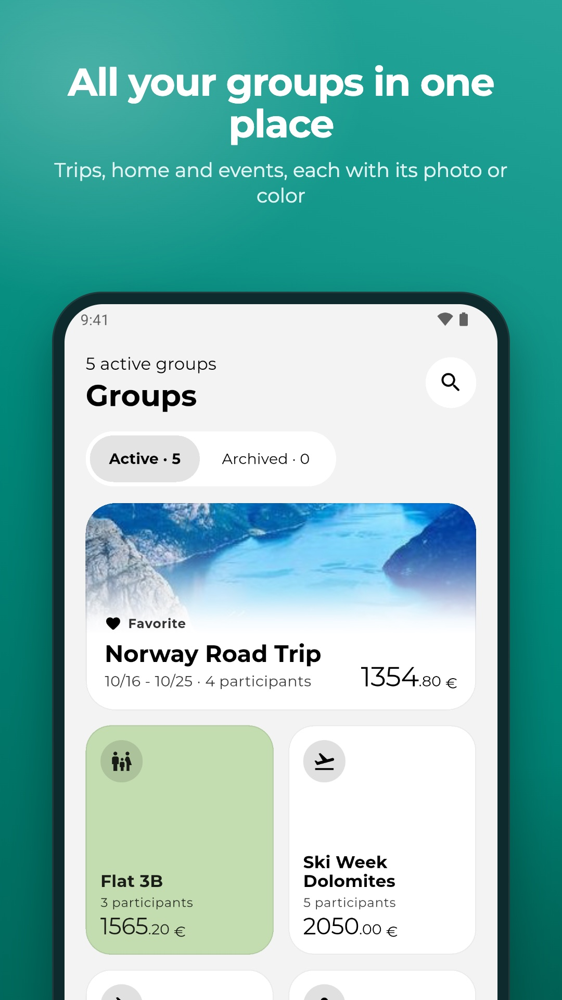
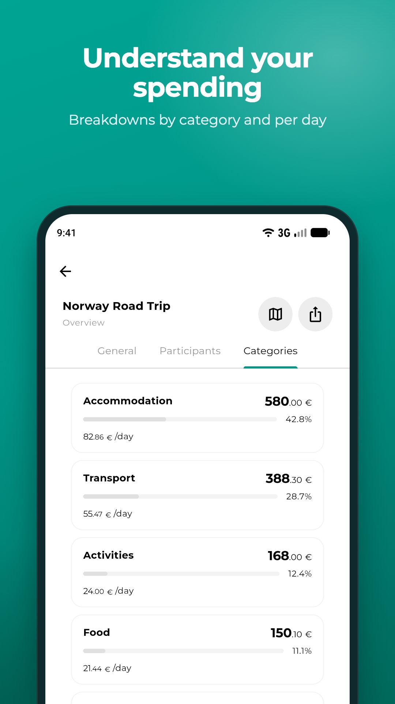
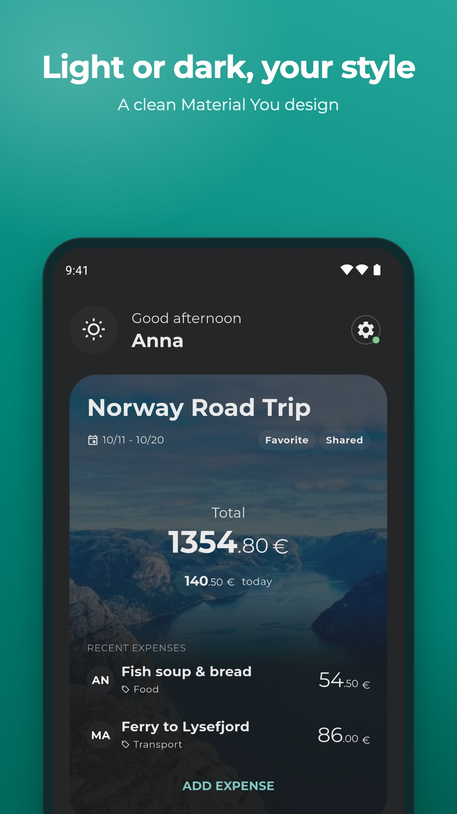

# Caravella: an Expense Tracker

  

  <strong>Modern group expense management for trips, shared costs, and participants</strong>

**Caravella** is a modern, multi-platform Flutter application designed to simplify expense management for groups, trips, and events. Built with Material 3, it offers an intuitive and clean user experience for tracking shared costs, managing participants, and settling debts.

Whether you're on a group trip, sharing an apartment with roommates, or organizing an event, Caravella helps you keep everything organized and transparent. All data is stored locally on your device, ensuring privacy and offline availability.

## ✨ Key Features

### Core Functionality
- **Group Management**: Create a group in a few short steps — what kind of group, its name, dates and currency, and who's taking part — and manage as many as you like
- **Expense Tracking**: Add an expense in seconds — amount, description, who paid and the category — with date, place, attachments and notes when you need them
- **Voice Input**: Say an expense ("I spent 12 euros at the stationery shop") and the form fills itself
- **Receipt Scanning with OCR**: Scan receipts using your camera or gallery to automatically extract expense amounts and descriptions (on-device processing, no internet required)
- **Smart Calculations**: Automatic calculation of who owes what to whom
- **Participant Management**: Easy addition and management of group members
- **Data Export**: Export your data to CSV or JSON formats for external analysis
- **Backup & Restore**: Back up to a file, or to your Google Drive with an optional weekly backup (Play Store version)
- **Device Sync (optional)**: Share a group with other people's devices over Wi-Fi or Bluetooth (QR pairing, end-to-end encrypted), or keep your own devices in sync through your personal Google Drive — off by default, enabled per group

### Location & Maps
- **Interactive Maps**: Visualize all expenses with locations on an OpenStreetMap view
- **Location Search**: Find and attach locations to expenses with autocomplete suggestions
- **Auto-Location Capture**: Automatic GPS retrieval when adding new expenses (optional, can be toggled)
- **Reverse Geocoding**: Automatically resolve addresses from coordinates

### Visual & Personalization
- **Photo Attachments**: Add photos to group backgrounds and expense records
- **Soft Group Colors**: 12 tints chosen for groups, pastel in the light theme and deep in the dark one
- **Clear Home**: Your group with its total, today's spending and a soft spending wave, plus the latest expenses
- **Dynamic Color Support**: Material 3 colors derived from device wallpaper (Android 12+)
- **Material Design 3**: Modern interface with smooth animations and transitions

### Updates & Convenience
- **Auto-Update Checks**: Weekly automatic update notifications (Play Store builds)
- **In-App Rating**: Smart prompts to rate the app at appropriate moments
- **Android Quick Actions**: Launch specific expense groups directly from your home screen
- **What's New Page**: View changelog and recent improvements directly in the app
- **Context Menus**: Long-press actions for quick group management (pin, archive, delete)

### Privacy & Localization
- **Privacy First**: All data stored locally on your device — sync is optional and never goes through a server we operate
- **Multi-language**: Available in English, Italian, Spanish, Portuguese, and Chinese
- **GDPR Compliant**: Full compliance with privacy regulations
- **Cross-Platform**: Built with Flutter, designed to run smoothly on Android smartphones, iOS, Web, and Desktop

### Perfect For:
- Group trips and vacations
- Shared household expenses
- Event planning and cost sharing
- Business trip expense tracking
- Roommate expense management

## 📱 Screenshots

  
  
  
  

  
  
  
  

## 🎉 What's New in v2.2.1

- **Swipe Between Tabs**: On the group page, swipe to move between Expenses, Balances and Statistics
- **One Field Style**: Every text field now looks and behaves the same

### v2.2.0

- **A Fresh New Look**: A floating bar to switch between Home and Groups, and every screen, sheet and dialog redesigned in one calm style
- **Home in Two Cards**: Your group with its total and today's spending, and the latest expenses right below
- **Easier Group Creation**: A few short steps, and you can add your friends straight away
- **Faster Expenses**: Read a receipt or say an expense from Home; the quick form keeps who paid and the category on one line
- **Softer Colors, Clearer Words**: Gentle group colors, vivid group photos, and texts reviewed in every language

## 🛠️ Tech Stack & Architecture

- **Framework**: Flutter 3.x with Material 3
- **UI**: Material Design 3 with dynamic color support
- **State Management**: `provider` for centralized and reactive state management
- **Storage**: SQLite database (`sqflite`) for high-performance data persistence with automatic migration from legacy JSON storage
- **Maps**: OpenStreetMap integration via `flutter_map` with Nominatim geocoding
- **Architecture**: Multi-package clean architecture with separation between:
  - `caravella_core`: Business logic, data models, and services
  - `caravella_core_ui`: Reusable UI components and themes
  - `play_store_updates`: Google Play Store update functionality (conditional)
  - Main app: Application-specific UI and features
- **Build Variants**: Factory pattern for Play Store and F-Droid distributions
- **Flavors**: Configured for different build environments (dev, staging, prod)

## 🔒 Privacy & Security

Caravella is designed with privacy as a core principle:

- **Local Storage**: All data is stored locally on your device - no cloud sync required
- **No User Accounts**: No online services or user accounts needed
- **Full Data Control**: You have complete control over your data with export and deletion capabilities
- **Optional Permissions**: Camera and location permissions are only requested when you explicitly use those features
- **GDPR Compliant**: Full compliance with privacy regulations

For complete details, see our [Privacy Policy](store/PRIVACY_POLICY.md) and [Permissions Documentation](store/permissions_documentation.md).

## 📦 Download & Installation

### Android
- **GitHub Releases**: [Download APK](https://github.com/calca/caravella/releases)
- **Google Play Store**: https://play.google.com/store/apps/details?id=io.caravella.egm
- **F-Droid**: Coming soon (see [F-Droid Submission Guide](docs/FDROID_SUBMISSION.md) for details)
- **Developer wiki**: see [docs/README.md](docs/README.md) for architecture and technical documentation
- **Device Support**: Optimized for smartphones only (tablets not supported)

### iOS
- **App Store**: Coming soon

Visit our [website](https://calca.github.io/caravella) for more information.

## 🤝 Contributing

Contributions are welcome! Please feel free to submit a Pull Request. For major changes, please open an issue first to discuss what you would like to change.

## 📞 Contact & Support

- **Project Repository**: https://github.com/calca/caravella
- **Issues**: https://github.com/calca/caravella/issues
- **Website**: https://calca.github.io/caravella
- **Privacy Inquiries**: privacy@caravella.app

## 📄 License

This project is licensed under the MIT License. See the `LICENSE` file for details.
