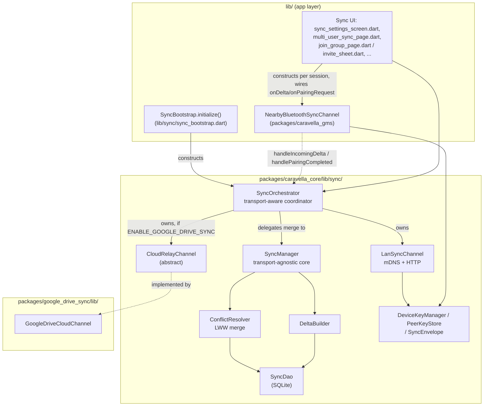
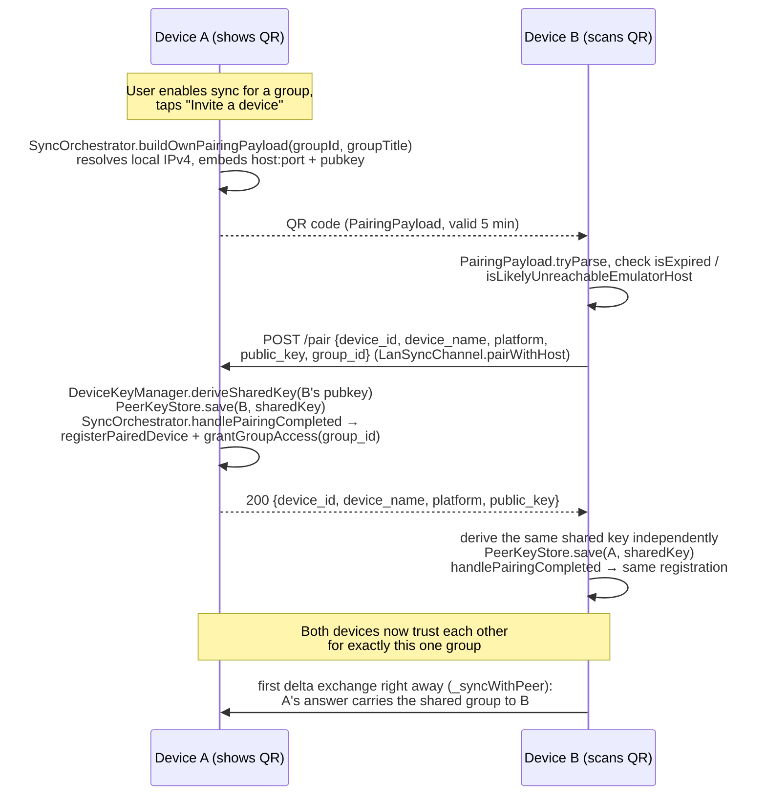

# Sync Architecture

Caravella's P2P sync lets a user exchange group/expense data directly between *their own* devices (or with someone else's, for a shared group) — over LAN, Bluetooth, or an optional Google Drive relay — with no backend server. This page documents how the ~6,700 lines across three channel implementations, the shared sync engine, and the app-level UI fit together; it's the missing piece the [Architecture Overview](ARCHITECTURE.md#feature-map-where-to-look) feature-map row previously just pointed at source directories for.

Read this after [caravella_core reference](PACKAGE_CARAVELLA_CORE.md) and, if you're touching the cloud channel specifically, [google_drive_sync package](PACKAGE_GOOGLE_DRIVE_SYNC.md) (which covers that one channel's internals in more depth and isn't repeated here).

## Layering



`BluetoothSyncChannel` is deliberately **not** owned by `SyncOrchestrator` the way `LanSyncChannel`/`CloudRelayChannel` are — it's constructed fresh per invite or join session by UI code (`BluetoothSyncFactory.createChannel`, called by `MultiUserSyncPage._join` for `JoinGroupPage` and `ExpenseGroupSyncPage._invite` for `InviteSheet`; the page or sheet stops it when closed) and pointed at the same orchestrator instance via two public methods that exist specifically for this: `SyncOrchestrator.handleIncomingDelta` and `.handlePairingCompleted` (`packages/caravella_core/lib/sync/sync_orchestrator.dart:359-388`). This is why those two methods are public despite everything else being routed through private helpers.

## Components

| Component | File | Role |
|---|---|---|
| `SyncOrchestrator` | `packages/caravella_core/lib/sync/sync_orchestrator.dart` | Single entry point the UI/DI talk to. Owns `LanSyncChannel` + optional `CloudRelayChannel`, merges their event streams, exposes pairing (`buildOwnPairingPayload`/`pairWithScannedPayload`), manual sync (`triggerManualSync`), history (`getHistory`) and the problems still to fix (`problems`, a `SyncProblemLog`). |
| `SyncManager` | `packages/caravella_core/lib/sync/sync_manager.dart` | Transport-agnostic core — doc comment explicitly says transport channels are "not part of this class." Owns `DeltaBuilder` + `ConflictResolver`, exposes `syncWithPeer`/`getOutgoingDelta` and all paired-device/grant CRUD (thin `SyncDao` passthroughs). |
| `ConflictResolver` | `packages/caravella_core/lib/sync/conflict_resolver.dart` | Applies an incoming delta with Last-Writer-Wins semantics inside one DB transaction; independently re-verifies the per-group grant before writing anything (see [Trust model](#trust-model-per-channel)). |
| `DeltaBuilder` | `packages/caravella_core/lib/sync/delta_builder.dart` | Builds the outgoing delta for a peer: every `sync_enabled` group changed since the last recorded sync *with that peer* and granted to it, each as a **full group snapshot**, not a field-level diff. |
| `SyncDao` | `packages/caravella_core/lib/sync/sync_dao.dart` | SQLite query layer over the sync tables added to the same DB `SqliteExpenseGroupRepository` uses (see [Storage](#storage-sqlite-schema) below). |
| `LanSyncChannel` | `packages/caravella_core/lib/sync/channels/lan_sync_channel.dart` | mDNS discovery (`bonsoir`) + an embedded `shelf`/`shelf_router` HTTP server (`/pair`, `/sync/delta`, `/sync/ping`) for the actual exchange. |
| `BluetoothSyncChannel` | interface in `packages/caravella_core/lib/sync/channels/bluetooth_sync_channel.dart`; implementation `NearbyBluetoothSyncChannel` in `packages/caravella_gms/lib/src/nearby_bluetooth_sync_channel.dart` (Play builds only — the F-Droid build has no Bluetooth sync, see [caravella_gms](PACKAGE_CARAVELLA_GMS.md)); created per session by `BluetoothSyncFactory.createChannel` | Manual-only (never auto-syncs) Nearby Connections channel. Same pairing philosophy as LAN (public-key handshake, per-group grant) but the *advertiser* unilaterally decides which group is on offer — see `_handleHello` in the Nearby implementation. Also does the symmetric update of an already-paired device (`startUpdate`, see [Updating a paired device over Bluetooth](#updating-a-paired-device-over-bluetooth)). Has its own chunking (32 KB payload limit, capped reassembly buffer, timeouts) since Nearby Connections payloads are smaller than a typical HTTP body. |
| `CloudRelayChannel` (abstract) → `GoogleDriveCloudChannel` | `packages/caravella_core/lib/sync/channels/cloud_relay_channel.dart` → `packages/google_drive_sync/lib/src/google_drive_cloud_channel.dart` | Interface lives in `caravella_core` so it stays independent of any concrete cloud SDK; the Google Drive implementation lives in its own conditional package. Full detail: [google_drive_sync package](PACKAGE_GOOGLE_DRIVE_SYNC.md). |
| `DeviceKeyManager` / `PeerKeyStore` / `SyncEnvelope` | `packages/caravella_core/lib/sync/crypto/` | X25519 keypair (generated once, persisted), ECDH+HKDF-SHA256 shared-key derivation, AES-256-GCM envelope encrypt/decrypt. Shared by LAN and Bluetooth; the cloud channel doesn't use this at all (see [Trust model](#trust-model-per-channel)). |
| `DeviceIdentity` | `packages/caravella_core/lib/sync/device_identity.dart` | `{deviceId (persisted UUID v4), deviceName (re-resolved via device_info_plus every launch, not persisted), platform}`. Singleton, `initialize()` must run once before use — done in `SyncBootstrap.initialize()` before `SyncOrchestrator` is constructed. |
| `SyncClock` | `packages/caravella_core/lib/sync/utils/sync_clock.dart` | The single source of truth for sync timestamps, always UTC — used instead of `DateTime.now()` everywhere in this subsystem so LWW comparisons can't break because two devices are in different timezones. |

## App wiring: `SyncBootstrap`

`lib/sync/sync_bootstrap.dart` runs once at startup (from a `FutureProvider`, so LAN mDNS/HTTP setup doesn't block first paint):

```dart
SyncOrchestrator(
  lanChannel: LanSyncChannel(),
  syncManager: SyncManager(repository: repository),
  cloudChannel: GmsIntegrations.instance.createCloudChannel(), // null unless ENABLE_GOOGLE_DRIVE_SYNC=true (and always in the F-Droid build)
)
```

Sync is unavailable entirely if the app is running on the legacy JSON storage backend (`--dart-define=USE_JSON_BACKEND=true` — see [Storage Backend](STORAGE_BACKEND.md)): `SyncBootstrap.initialize()` returns `null` in that case (`lib/sync/sync_bootstrap.dart:17-21`), because `SyncDao` depends on SQLite-specific columns/tables that don't exist on the JSON repository.

### Sync → UI: `SyncActivity`

`lib/sync/sync_activity.dart` (a `ChangeNotifierProxyProvider<SyncOrchestrator?, SyncActivity>` in `provider_setup.dart`, attached once the orchestrator exists) listens to `SyncOrchestrator.events`:

- a `SyncCompleted` with `applied > 0` calls `ExpenseGroupNotifier.notifyGroupUpdated` for each id in `result.groupIds`, so Home, Groups and an open group page (which reloads on a new notifier `revision`) show synced changes without a manual refresh;
- a group shared with this device for the first time (the `ConflictResolver` saved it and it didn't exist locally) is reported in `SyncResult.newGroupIds`, with the sender's `peerName`; `SyncActivity` records a pending welcome (`PreferencesService.sharedGroups`, group id → device name) and `AppShell` shows a toast ("Pixel 9 shared “Norway Road Trip” with you", with **Open** to go to the group). On its first open the group page shows `GroupWelcomeCard` (who shared it, people, expenses, total so far; OK / Add expense), dismissed for good by either button
- the overall state is shown on Home by `HomeSyncButton` (`lib/sync/settings_sync_badge.dart`), a raised round button next to the settings gear, shown only while a sync runs or after a failure (hidden when all is fine or no channel is on): the sync arrows in the text color, turning while syncing, with an ochre dot in the corner while something is still to fix — `SyncOrchestrator.problems` is not empty (the same dot language as the groups' "Shared" badge) — a peer that can't be reached (`SyncFailed.unreachable`, e.g. on another network) is the normal state of device-to-device sync and doesn't count as a failure; no cloud icons; it opens `SyncSettingsScreen`, which then starts with a **To fix** group: one `SyncProblemTile` (`lib/sync/sync_problem_tile.dart`) per problem — "Norway · Pixel 9", why and what to do, how long ago — opening the pairing page (Drive's page for the cloud). A `SyncProblem` (`caravella_core`) has a reason (`notShared`: the peer sent a group not shared with it here; `unreadable`; `notPaired`: no key on file; `peerError`: the peer answered with an error; `cloudUnreachable`; `failed`), the channel, the peer (id, and name when it said), the group when it's about one, and the time. `ConflictResolver` adds one to `SyncResult.problems` per error; `LanSyncChannel`/`SyncManager` put the reason and peer on `SyncFailed`, and the orchestrator records a failed exchange in the history too (`failed: true`). `SyncProblemLog` keeps them in memory, newest first, at most 20: a group's problem with a device goes when a later exchange with that device carries the group cleanly, a whole-exchange problem when an exchange with that device goes through, the cloud's when Drive answers; the same problem again replaces the older one. Device names come from the paired devices (`SyncNames`), group titles from storage. The history page shows the device by name, the channel and what was exchanged (or "didn't go through"), and the problems under it ("Norway: …"). Synced groups show a "Shared" pill (`GroupSyncBadge`, Home card and group page) with a dot in the same language: filled green when the group synced in the last 24 hours, filled ochre when the last exchange that carried it had errors, hollow grey when it hasn't synced for 24 hours or ever (`SyncOrchestrator.getGroupSyncStatus` → `GroupSyncStatus`: the in-memory history first, then `SyncDao.getLastGroupSyncTime` — the latest `sync_log` row of a device granted the group — so the time survives a restart; an unreachable peer is not an error, the group just goes stale). Screen readers read the state with the label. `SettingsSyncBadge` (dot on an icon) remains in Settings and group settings.

## Storage: SQLite schema

`SyncDao` reads/writes five things, all added as additive migrations on the same database `SqliteExpenseGroupRepository` owns (see [Storage Backend](STORAGE_BACKEND.md) for the full migration history):

| Table / columns | Added at | Purpose |
|---|---|---|
| `groups.device_id, updated_at, deleted, sync_version, sync_enabled` | schema v3 | Sync metadata bolted onto the existing groups table. `sync_enabled` is the privacy boundary — a group must be explicitly marked shared before any of its data is eligible to leave the device, on **any** channel. |
| `device_meta` (`device_id` PK, `device_name`, `last_seen`, `vector_clock`) | v3 | Last-seen bookkeeping per peer. `vector_clock` exists but is currently unused — `SyncDao.upsertDeviceMeta` always passes `null` for it. |
| `sync_log` (autoincrement id, `peer_id`, `channel`, `synced_at`, `delta_sent`, `delta_recv`) | v3 | Append-only exchange log; backs both `lastSyncTime` and the sync-history UI. |
| `paired_devices` (`device_id` PK, `device_name`, `platform`, `paired_at`, `public_key`) | v4 (`public_key` added v5) | Device identity + trust. `public_key` is nullable for pairings created before E2E encryption existed — every sync path explicitly rejects such a device rather than falling back to plaintext. |
| `paired_device_groups` (`device_id`, `group_id`, `granted_at`, composite PK) | v5 | Per-group access grant — a second, narrower boundary on top of `paired_devices`. **Being paired grants nothing by itself** (see below). |

`SyncDao.isGroupSynced`/`getAllGroupSyncStatuses` compare a group's `updated_at` against the **global** max `synced_at` in `sync_log`, not a per-peer one — since a full delta exchange updates every shared group at once, one successful sync with *any* peer is treated as bringing every shared group current. Practical effect: the sync-status badge can't distinguish "synced with peer X" from "synced with peer Y."

## The delta shape

`DeltaBuilder.buildDelta` (`packages/caravella_core/lib/sync/delta_builder.dart`) produces:

```json
{
  "schema": 1,
  "device_id": "...",
  "device_name": "...",
  "timestamp": 1234567890,
  "groups": [ /* full ExpenseGroup.toJson() output, each with an added "_sync" block: device_id, updated_at, sync_version */ ],
  "deleted_groups": [ { "id": "...", "updated_at": 1234567890 } ]
}
```

This is a **full-snapshot-per-changed-group** delta, not a field-level diff — every entry in `groups` is the entire group (participants, categories, expenses, attachments) as of now, not just what changed. `ConflictResolver._saveGroupInTransaction` (`packages/caravella_core/lib/sync/conflict_resolver.dart:268-351`) applies it the same way: replace the group row, delete-and-reinsert every child row. There is no field-level merge anywhere in this pipeline.

### Format version

Because the whole group is replaced, an older app that doesn't know a field drops it when it stores the group, and sends the group back without it on its next change, which erases it on the newer device too. So `schema` (`DeltaBuilder.schemaVersion`, 1 since 2.4.1) is raised whenever the group JSON gains data an older app can't keep, and `DeltaBuilder.parseDelta` throws `NewerFormatException` for a delta with a higher one. `SyncManager` reports it like any unreadable delta (`SyncProblemReason.unreadable`: "Couldn't be read: update Caravella on both devices") and nothing is applied. A delta without `schema` comes from 2.4.0 and counts as 1. The Google Drive relay envelope has its own `schema` (`GroupSerializer`), and `deserializePayload` skips a payload whose version is higher. 2.4.0 itself checks neither, so a newer app still has to keep what a 2.4.0 peer would erase — see #676.

Inclusion in a delta requires all three: changed since the last recorded sync *with that specific peer*, `sync_enabled = 1`, and explicitly granted to that peer (`SyncDao.getGroupsDeltaSince`/`getDeletedGroupsSince`, `packages/caravella_core/lib/sync/sync_dao.dart:37-80`).

## Conflict resolution: Last-Writer-Wins

`ConflictResolver.applyDelta` (`packages/caravella_core/lib/sync/conflict_resolver.dart:35-234`), one DB transaction per call:

1. No local row for this group → upsert unconditionally (new group).
2. Local row exists → compare incoming `_sync.updated_at` against the local `groups.updated_at`:
   - Remote newer → overwrite (upsert).
   - **Tie or local newer → skip.** A tie means **local wins** (`conflict_resolver_test.dart:244`, `'same timestamp — local wins (tie-break)'`).
3. Deletions follow the identical comparison, applied as a soft delete (`deleted = 1`) rather than a row removal.
4. Deleting a group this device never saw is a no-op.

**Independent grant re-check** (`_isGrantedInTxn`, `packages/caravella_core/lib/sync/conflict_resolver.dart:245-258`): before writing *any* upsert or deletion, `ConflictResolver` re-queries `paired_device_groups` itself, inside the same transaction — it does not trust that the sender only ever includes groups it was granted. An ungranted group is rejected and counted as an error, not silently skipped. This is defense-in-depth on top of the query-level filtering `DeltaBuilder` already does on the *sending* side, so a compromised or buggy sender can't push a group the receiver never granted.

## Trust model per channel

Pairing and group access are two separate, independently-enforced boundaries everywhere in this subsystem — confirmed by `SyncManager.registerPairedDevice`'s own doc comment: *"This establishes identity and encryption key material only — it does not grant access to any group"* (`packages/caravella_core/lib/sync/sync_manager.dart:148-150`), and by the test named `'remote group is rejected when the peer was never granted access to it — even though pairing exists, being paired alone grants nothing'` (`packages/caravella_core/test/sync/conflict_resolver_test.dart:128-129`).

- **LAN**: pairing is a QR-code exchange (see [Pairing flow](#pairing-flow-qr-code-lan) below) scoped to exactly the one group the QR was generated for. Auto-sync afterward (mDNS rediscovery) is gated only on `SyncManager.isPeerPaired` (device-level) — the per-group grant check happens later, inside `ConflictResolver`.
- **Bluetooth**: same pairing mechanics (X25519 handshake, per-group grant), but manual only — never auto-discovers-and-syncs the way LAN does. The connecting device has no say in which group it's granted; whichever group the advertiser passed to `startAdvertising(groupId, ...)` is what gets shared.
- **Cloud (Google Drive)**: **no pairing/trust step at all.** Trust is delegated entirely to the signed-in Google account — the channel only ever reads/writes that account's own private `appDataFolder`. There is no `SyncDao`/`ConflictResolver` per-group-grant check anywhere in this path; `downloadAllShards()` returns every shard file the account owns, full stop. This is architecturally consistent with the feature's framing ("sync your own devices via your own Google account"), but it does mean the `sync_enabled` per-group flag is the *only* gate on the cloud path — there's no second, per-peer boundary the way LAN/Bluetooth have.

Encryption (`DeviceKeyManager`/`PeerKeyStore`/`SyncEnvelope`) is LAN+Bluetooth only. Cloud relies on Drive's own transport security (HTTPS) plus the `appDataFolder` scope being invisible to every app but this one — there's no additional app-level encryption layer on top for the cloud path.

## Pairing flow (QR code, LAN)



`handlePairingCompleted` emits a `PeerPaired` event (`deviceId`, `deviceName`, `groupId`, `channel`: `"lan"` or `"bluetooth"`) on `SyncOrchestrator.events`, on both sides; `BluetoothSyncFactory.createChannel` wires the Bluetooth channel's pairing callback with `channel: 'bluetooth'`. `PairedDevicesList` reloads on it, so the new device appears without reopening the page. B starts the first exchange itself at the end of `pairWithHost` (in the background, so the scan page closes at once): A had most likely already been discovered over mDNS before the pairing and skipped as unpaired, and mDNS doesn't announce it again, so without this the group only arrived after an app restart.

## Invite and Join (the UI)

One flow for both transports, so the user never picks one:

- **Invite** — the group's sync page (`ExpenseGroupSyncPage`) has a single "Invite a device" button opening `InviteSheet` (`lib/sync/invite_sheet.dart`): the QR code (when Wi-Fi sync is on, with its 5-minute countdown) and, in builds with Bluetooth, advertising for as long as the sheet is open ("Visible to nearby phones"). The advertised Nearby endpoint name is `BluetoothEndpointName.encode(deviceName, groupTitle)` (device name, newline, group title cut to 40 characters; older versions advertise the name alone and decode the same way). The sheet closes itself with a "Synced with …" toast on a `PeerPaired` for its group on `"lan"`; on `"bluetooth"` it shows "Syncing with …" and closes one second after the channel's `BtSyncCompleted`, so the answer leaves the phone before advertising stops.
- **Join** — Settings › Synchronization › Sync with others (`MultiUserSyncPage`) starts with "Join a group", opening `JoinGroupPage` (`lib/sync/join_group_page.dart`): the camera for the QR code (when Wi-Fi sync is on; otherwise a "Turn on" button that switches it on) and, below, the nearby phones found over Bluetooth (when the Bluetooth switch is on; otherwise "Turn on") with the group they invite to — "Join", or "Update" when a paired device has that name. Either way it pops with a "Synced with …" toast. Hidden where neither a camera scanner nor Bluetooth exists; the F-Droid build has a free scanner (`ZxingQrView`), so it shows Join too.
- **Privacy switches** — under "How Caravella can sync" in `MultiUserSyncPage` (named "Sync over …" so they don't read as the phone's own Wi-Fi and Bluetooth, which they never touch): **Sync over Wi-Fi** (`setLanSyncEnabled`: mDNS, the HTTP server and automatic sync on the same network) and **Sync over Bluetooth** (`BluetoothSyncFactory.isUserEnabled`/`setUserEnabled`, the `sync_bluetooth_enabled` preference, off by default; hidden in builds without Bluetooth). With both off the phone isn't visible and receives nothing. Even when allowed, Bluetooth runs only while Invite or Join is open; while it isn't, both show "Bluetooth sync is off" with a **Turn on** button that flips the switch and starts it. A group can be shared only while one of the two is on — otherwise `ExpenseGroupSyncPage` locks its switch off and offers **Turn on in Settings**, which opens `MultiUserSyncPage` and re-reads both on return.

- **Paired devices** — `PairedDevicesList` (`lib/sync/widgets/paired_devices_list.dart`): under "Shared with" on the group's sync page (the devices granted that group) — with no device yet it shows an empty state instead ("Shared with no one yet", what sharing is for, **Invite a device**), and once there are devices, a last "+ Invite another device" row (`emptyBuilder`, `trailing`, `onLoaded` on the list) and under "Paired devices" in `MultiUserSyncPage` (every device, with the groups it shares). Each row has a dot in the language of the groups' "Shared" pill and a line from `SyncOrchestrator.getDeviceSyncInfo` (`DeviceSyncInfo`: the last exchange, from this session's history, else the sync log; whether it failed; its granted groups): "Updated 2h ago", "Never updated · paired 7 Nov" or "Last exchange didn't go through". Tapping a row opens `PairedDeviceSheet` (`paired_device_sheet.dart`), with last update, pairing date and shared groups, and two actions. **Update now** is one button, Wi-Fi first and then Bluetooth: with "Sync over Wi-Fi" on it runs `triggerManualSync('lan')` and waits up to 15 s for a `SyncCompleted`/`SyncFailed` from that device (answered: "Synced with …" and the sheet closes); if Wi-Fi is off or the device didn't answer, and Bluetooth is available (`BluetoothSyncFactory.isEnabled`; with the privacy switch off the sheet shows a **Turn on** panel that calls `setUserEnabled(true)`), the sheet moves to the Bluetooth step described under [Updating a paired device over Bluetooth](#updating-a-paired-device-over-bluetooth). Without Bluetooth in the build (F-Droid) it's disabled while "Sync over Wi-Fi" is off, as before. The second action, after a confirmation, is **Take off «group»** (`revokeGroupAccess`, from a group) or **Forget this device** (`removePairedDevice`, from Settings). The channel isn't shown, because `sync_log` records Bluetooth exchanges as `lan` (see Known issues).

Bluetooth pairing is the same idea with a different transport: an unencrypted `hello`/`hello_ack` handshake over Nearby Connections (`NearbyBluetoothSyncChannel.syncWithPeer` on the connecting side, `_handleHello` on the advertising side — `packages/caravella_gms/lib/src/nearby_bluetooth_sync_channel.dart`) instead of QR + HTTP — the key exchange and grant-writing steps afterward are identical.

### Updating a paired device over Bluetooth

The Bluetooth step of **Update now** (`PairedDeviceSheet`, and `BluetoothSyncChannel.startUpdate(targetDeviceId)` in `caravella_core` / `NearbyBluetoothSyncChannel` in `caravella_gms`) refreshes two phones that are *already paired*, without pairing again. Both phones run the same screen, so each one **advertises and discovers at the same time** (Nearby Connections allows both), and only the target device counts:

- **Endpoint info** — an update advertises `BluetoothEndpointName.encodeUpdate(deviceName, deviceId)`: the device name (cut to 30 characters), an empty title line, then `upd:<deviceId>`. `decode` returns it as `updateDeviceId`, and `PeerFound.updateDeviceId` carries it to the UI; invitations (`name\ngroupTitle`) and the older name-only form decode as before with `updateDeviceId == null`. The ID comes from the advertisement, not from the editable device name; `JoinGroupPage` ignores update advertisements, and the sheet ignores everything that isn't `PairedDevice.deviceId`.
- **Tie-break** — `BluetoothUpdate.initiates(ownDeviceId, peerDeviceId)`: the phone with the lexicographically smaller device ID calls `syncWithPeer`; the other only waits. The waiting phone completes the exchange like an advertiser does (`_handleHello` → `hello_ack`, then `_handleIncomingSync`) and reports it with `BtSyncCompleted`.
- **Auth** — while an update is active (`_updateTargetId`), a `hello` is answered only if its `device_id` is the target *and* the key derived from its public key equals the key already in `PeerKeyStore` (keys come from fixed per-device X25519 key pairs, so a genuine paired device always matches; an unknown device, or one claiming the target's ID with another key, gets no answer). No `PeerKeyStore.save`, no `onPairingRequest`, no group grant happens, the `hello_ack` carries no `group_id`, and an incoming `sync` from any other device ID is dropped. The initiating side applies the same check to the `hello_ack`. The deltas are the usual ones for the paired device (only its granted groups).
- **Collisions** — with the tie-break only one phone requests the connection, so the usual case has none. If the request still fails (Nearby reporting "already connected" or an I/O error because the other direction got there first), the sheet doesn't fail: it waits `collisionGrace` (3 s) for a `BtSyncCompleted` from the other direction, retries once, then shows "Couldn’t connect" with **Retry**.
- **Result** — `SyncResult.sent` (new) and `applied` count changes (groups + deletions, `BluetoothUpdate.countChanges`) for "Received N, sent M"; the sheet closes 1.5 s later with the "Synced with …" toast. **Cancel**, and closing the sheet, call `stopAll()` and `dispose()`.

## Delta sync flow (already-paired devices, LAN)

```mermaid
sequenceDiagram
    participant A as Device A (initiator)
    participant B as Device B

    A->>A: mDNS resolves B; isPeerAuthorized(B) check;<br/>GET /sync/ping
    A->>A: PeerKeyStore.get(B) — abort with a<br/>"re-pair required" log if no key on file
    A->>A: build outgoing delta (DeltaBuilder, see above)<br/>SyncEnvelope.encrypt
    A->>B: POST /sync/delta {envelope}
    B->>B: isPeerAuthorized(A) check; SyncEnvelope.decrypt;<br/>ConflictResolver.applyDelta (LWW merge, grant re-check)
    B->>B: build its own outgoing delta for A; encrypt
    B-->>A: 200 {envelope}
    A->>A: decrypt; ConflictResolver.applyDelta<br/>(same LWW merge, on A's side)
    Note over A,B: One HTTP round trip achieves<br/>bidirectional convergence
```

Confirmed by the integration test titled `'two devices converge after bidirectional sync'` (`packages/caravella_core/test/sync/sync_integration_test.dart:100`).

## Known gaps / TODOs

- **The Google Drive channel currently only downloads, never uploads, at runtime.** `GoogleDriveCloudChannel.uploadShard` and the `LocalJsonStore`/`GroupSerializer` machinery it would use are fully implemented and unit-tested in isolation, but nothing calls `uploadShard` from `SyncOrchestrator`, any UI page, or the periodic-polling `start()` loop — verified by grepping every call site in the repo. Worse: the shards `downloadAllShards()` does fetch are never merged into the local DB either — `SyncOrchestrator.initialize`'s `onShards` callback for the cloud channel only logs the count (`packages/caravella_core/lib/sync/sync_orchestrator.dart:114-120`). As shipped, the cloud channel doesn't move data in either direction end-to-end; treat it as inert until this is wired up, not as a third peer to LAN/Bluetooth.
- **`SyncManager.syncWithPeer` is always called with the channel name hard-coded to `'lan'`** inside `SyncOrchestrator._handleDelta` (`packages/caravella_core/lib/sync/sync_orchestrator.dart:402`), even when the delta arrived via `handleIncomingDelta` from `BluetoothSyncChannel`. So the `sync_log.channel` column (and anything reading it) will record Bluetooth-originated exchanges as `'lan'`. This doesn't affect the `SyncResult` a Bluetooth sheet shows the user directly — `BluetoothSyncChannel.syncWithPeer` tags its own returned `SyncResult.channel` correctly as `'nearby'` — the discrepancy is specifically in the `sync_log` table.
- Chunking/timeouts are Bluetooth-specific (32 KB max payload, ~128 MB reassembly cap, 15s handshake / 30s response timeouts — see `packages/caravella_gms/lib/src/nearby_bluetooth_sync_channel.dart`). LAN relies on a single HTTP body; Cloud on a single Drive file per device — neither has (or currently needs) analogous limits.

## See also

- [Architecture Overview](ARCHITECTURE.md) — package boundaries, app startup sequence
- [caravella_core reference](PACKAGE_CARAVELLA_CORE.md) — the rest of `caravella_core`, including storage
- [google_drive_sync package](PACKAGE_GOOGLE_DRIVE_SYNC.md) — the cloud channel implementation in depth
- [Storage Backend](STORAGE_BACKEND.md) — full SQLite schema/migration history, including the sync-specific migrations summarized above
- [Testing Guide](TESTING.md) — where sync tests live (`packages/caravella_core/test/sync/`) and how to run them
